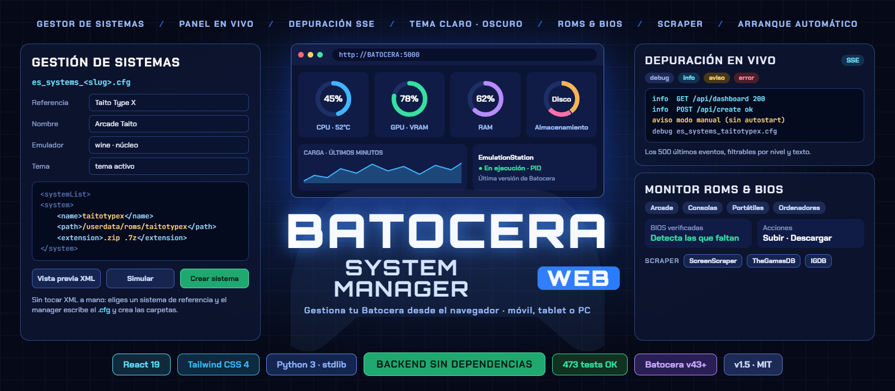
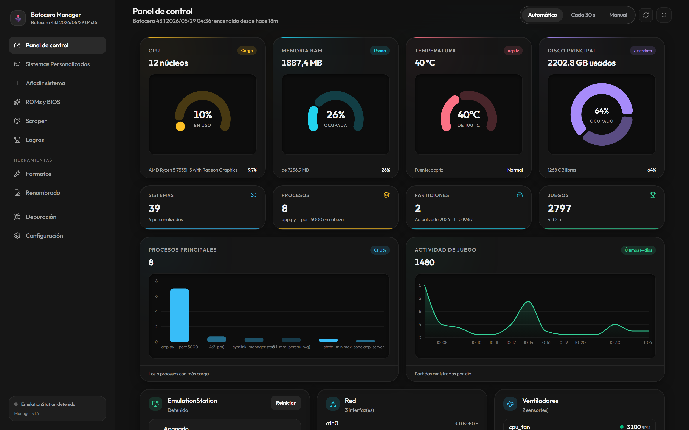
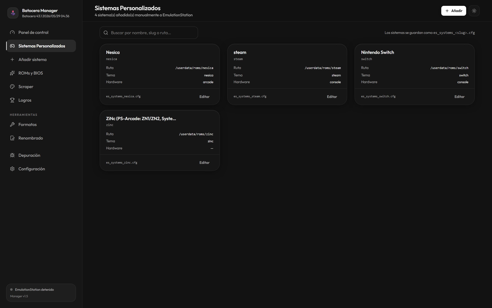
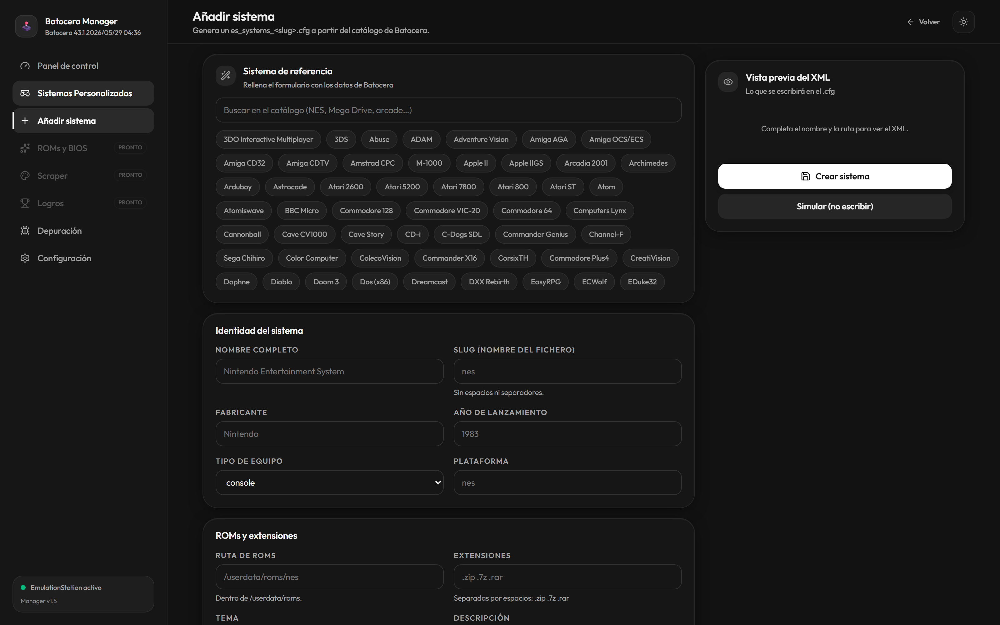
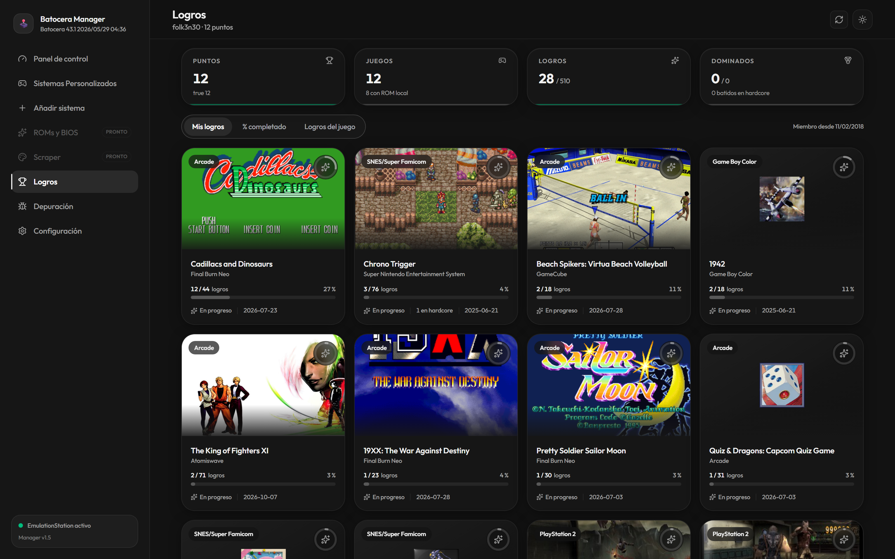
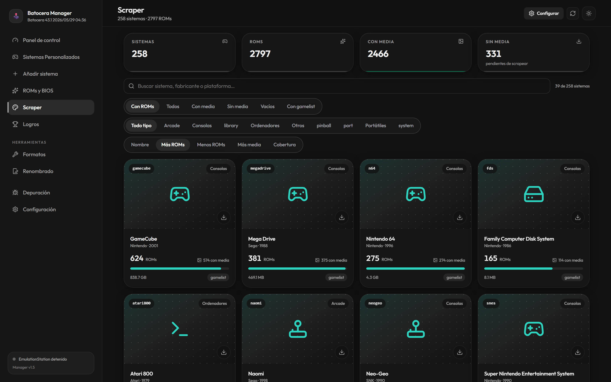
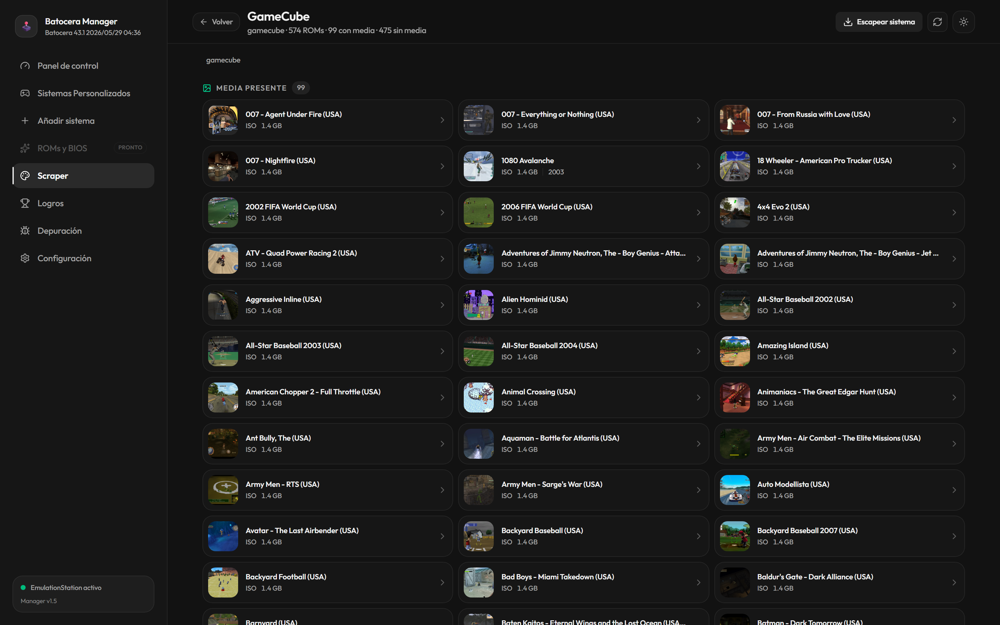
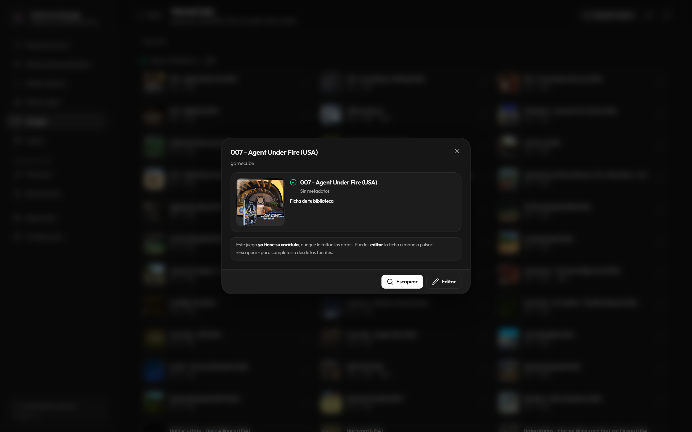
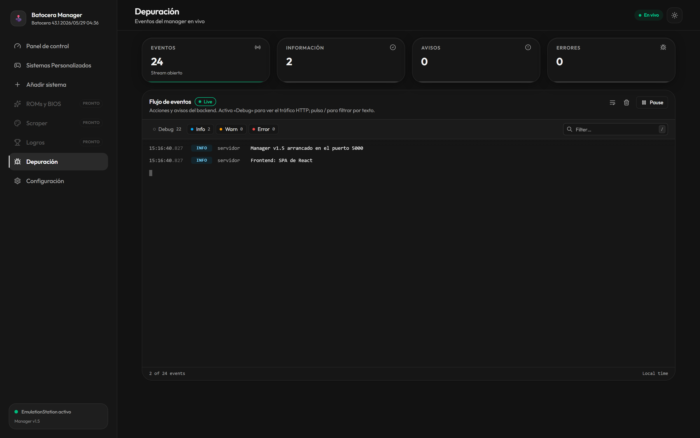
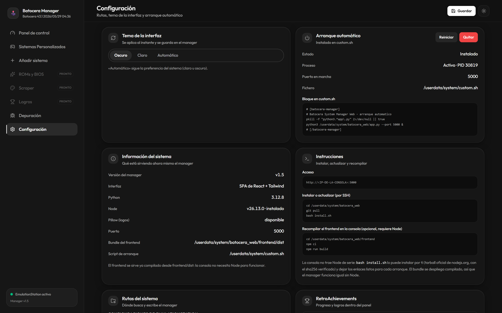

<div align="center">

# 🕹️ Batocera System Manager Web

**Interfaz web para gestionar tu Batocera desde el navegador**: sistemas personalizados,
ROMs, BIOS, temas, carátulas y scraping — sin tocar la línea de comandos.

> **Un solo proyecto, un solo repositorio.** La interfaz es una SPA en React + Tailwind CSS y el
> backend sigue siendo **Python puro** (sin dependencias). La interfaz clásica de un solo
> fichero (`templates/index.html`) se conserva como **respaldo**: si el bundle compilado no está
> en la consola, el backend sirve esa en su lugar.
>
> Durante el desarrollo el proyecto estuvo partido en **dos repositorios** con el mismo backend.
> Se unificaron porque mantener dos copias del mismo `app.py` obligaba a propagar cada cambio a
> los dos sitios. El [motivo de la unificación](#-por-qué-un-solo-repositorio) está contado más
> abajo.

[](https://github.com/Thundertruck4K/batocera-web-manager/releases)
[](LICENSE)
[](https://batocera.org)
[](https://docs.python.org/3/)
[]()
[](frontend)
[](frontend)
[](tests)
[](https://github.com/Thundertruck4K/batocera-web-manager/stargazers)
[](https://github.com/Thundertruck4K/batocera-web-manager/forks)
[](https://github.com/Thundertruck4K/batocera-web-manager/issues)
[](https://github.com/Thundertruck4K/batocera-web-manager/commits/master)
[](https://github.com/Thundertruck4K/batocera-web-manager)



**Proyecto de código abierto** · Licencia MIT · Backend en Python puro (sin dependencias) · Interfaz en React + Tailwind CSS  
[Instalación](#-instalación) · [Capturas](#-capturas) · [API](#-api-rest) · [FAQ](#-preguntas-frecuentes) · [Apoyar el proyecto](#-apoyar-el-proyecto)

</div>

---

## 🧭 Índice

| | | |
|:--|:--|:--|
| [¿Qué es?](#-qué-es) | [Instalación](#-instalación) | [API REST](#-api-rest) |
| [Un solo repositorio](#-por-qué-un-solo-repositorio) | [Características](#-características) | [Uso](#-uso) |
| [Capturas](#-capturas) | [Tests](#-tests) | [Scraper de carátulas](#-scraper-de-carátulas) |
| [BIOS](#-bios) | [Estructura del proyecto](#-estructura-del-proyecto) | [Arquitectura](#-arquitectura) |
| [Requisitos](#-requisitos-y-compatibilidad) | [Seguridad](#-seguridad) | [Preguntas frecuentes](#-preguntas-frecuentes) |
| [Roadmap](#-roadmap) | [Contribuir](#-contribuir) | [Apoyar el proyecto](#-apoyar-el-proyecto) |
| [Licencia](#-licencia) | | |

---

## ❓ ¿Qué es?

**Batocera System Manager Web** es una interfaz web autocontenida para administrar un equipo con
[Batocera](https://batocera.org) desde cualquier navegador de la casa: el móvil, la tablet o el PC.

EmulationStation sólo muestra los sistemas que ya están definidos en sus ficheros `es_systems.cfg`
(escritos a mano, en XML, por SSH). Esta herramienta convierte esa tarea en un formulario:
eligues un sistema de referencia de Batocera, ajustas nombre, extensiones, emulador, núcleo y tema,
y el manager escribe el `es_systems_<slug>.cfg` correcto y crea las carpetas necesarias.

Además del gestor de sistemas, incluye un **panel de control en vivo** (CPU, GPU, RAM, disco y
ventiladores, más el estado de EmulationStation y las últimas versiones de Batocera, leídos de
`/proc` y `/sys`), un **monitor de ROMs y BIOS** que agrupa los sistemas por tipo de equipo, una
**sección de BIOS** que verifica cada fichero contra el catálogo oficial de la propia consola (y lo
repara sin salir de la SD), un **scraper multi-fuente** y un asistente de **arranque automático**.

En el dispositivo **no hay que compilar nada**: el bundle de la interfaz ya viene compilado en el
repositorio y el backend lo sirve tal cual. El backend **no tiene ni una dependencia**: es un
servidor HTTP de la librería estándar de Python. Node sólo hace falta si quieres tocar la interfaz;
para usarla en Batocera, ni siquiera eso.

La interfaz que se sirve es una **SPA de React + Tailwind CSS** (en `frontend/`, compilada y
versionada). La interfaz clásica de un solo fichero (`templates/index.html`) sigue viva como
**respaldo**: si el bundle no está en la consola, el backend sirve esa en su lugar sin que te
enteres. Las dos hablan con la misma API.

## 🧩 ¿Por qué un solo repositorio?

El proyecto llegó a este estado por una razón práctica: durante buena parte del desarrollo se
mantuvieron **dos repositorios** con el mismo backend.

| | Variante React | Variante «Python puro» |
|:--|:--|:--|
| Interfaz | `frontend/` — SPA de React + Tailwind | `templates/index.html` — todo en un fichero |
| Backend | `app.py` | `app.py` **idéntico** salvo `APP_REPO` |
| Instalador | `install.sh` con fase de Node | `install.sh` sin fase de Node |

Mantener dos copias del mismo backend (unas 6000 líneas) no sale gratis: cada corrección tenía que
aplicarse en los dos repositorios, y hacía falta un comprobador automático para que no se
desincronizaran en silencio. Para un proyecto de una persona, eso es mantenimiento puro sin
beneficio para quien lo usa.

La unificación deja las cosas así:

- **Un solo backend** (`app.py`), una sola API y un solo instalador.
- **Dos interfaces sobre ese backend**: la SPA de React es la principal; la clásica de un solo
  fichero queda como respaldo y el backend la sirve automáticamente si el bundle no está.
- **El repositorio de la variante «Python puro» se eliminó** —era `batocera-web-manager`, el mismo
  nombre que recupera este— y su historial quedó aquí: su `master` es un ancestro directo de
  este, así que no se perdió ni un commit.
- La API no cambia: las dos interfaces consumen los mismos endpoints `/api/*`.

## ✨ Características

- **🕹️ Gestor de sistemas** — crea, edita y elimina sistemas personalizados con formulario completo,
  vista previa del XML y registro de lo que se escribe en disco.
- **📊 Panel de control en vivo** — velocímetros de CPU (uso, núcleos, temperatura), GPU (modelo,
  uso, VRAM, consumo) y RAM; almacenamiento y ventiladores; estado/PID de EmulationStation y las últimas
  versiones oficiales de Batocera. Con refresco automático opcional.
- **🎲 Juego al azar + estadísticas** — tarjeta con carátula, ficha y descripción de un juego aleatorio
  de tu biblioteca, ranking de más jugados y horas totales. Se rellena sola al abrir la app (con sistema,
  carátula y metadatos) y el botón **Girar** sigue ahí para pedir otro cuando quieras.
- **📚 Contadores que cuentan el disco** — las tarjetas de *Sistemas* y *Juegos* del panel cuentan lo que
  hay **de verdad en la SD**: los sistemas con juegos (no sólo los personalizados) y los juegos reales
  (ficheros de juego y carpetas de juego), no lo que diga el `gamelist.xml`.
- **🎨 Tarjetas con gráficos propios** — todo el panel usa un lenguaje de tarjetas redondeadas con
  color propio: velocímetros de 240°, sparklines de área, un donut de reparto del disco y barras
  redondeadas. En la SPA se dibujan con Recharts; en la interfaz clásica, en CSS/JS puro.
- **🚀 Arranque automático** — añade o quita el manager del `custom.sh` de Batocera con un clic, y
  avisa en pantalla si está corriendo en modo manual (lanzado a mano, sin arranque automático).
- **🧩 Dos interfaces, un backend** — la SPA de React es la que se sirve por defecto; la clásica de
  un solo fichero queda de respaldo si el bundle no está compilado en la consola.
- **🌗 Tema claro/oscuro** — la interfaz se puede ver en oscuro (por defecto) o en claro, y también
  seguir la preferencia del sistema. El botón del sidebar alterna al instante; en Configuración se
  elige el modo. Se guarda en el manager, así que se aplica igual desde el móvil o el PC.
- **🐞 Depuración en vivo** — una vista de depuración con el flujo de eventos del manager en tiempo
  real: cada petición, acción y aviso llega por SSE y se puede filtrar por nivel (debug, info, aviso,
  error) y por texto. El historial vive en memoria en el servidor (los 500 últimos eventos).
- **🏆 Dashboard de logros** — los juegos de RetroAchievements en los que más has desbloqueado, en
  tarjetas con **la carátula que dejó el scraper** en tu biblioteca, el porcentaje de completitud y el
  estado de cada juego (dominado, completado, batido, en progreso). Se puede ordenar por logros
  obtenidos, por porcentaje o por logros totales. Si no hay cuenta configurada, la sección avisa y te
  lleva a Configuración.
- **🧲 Scraper en la SPA** — los sistemas de tu biblioteca en tarjetas con un icono temático, su
  nombre, una breve descripción y el número de ROMs. Al abrir uno, sus ROMs se reparten en *media
  presente* y *media ausente*; con un modal flotante se escapea el sistema entero o un juego suelto,
  con la carátula a la vista y las tres fuentes en orden de prioridad (ScreenScraper primero y
  TheGamesDB e IGDB como respaldo).
- **🌐 Cero dependencias** — sólo la librería estándar de Python. Opcionalmente Pillow, y sólo para
  generar logos de relleno.

### Lo que aún está en la interfaz clásica

El backend y la API lo tienen todo, pero estas secciones **todavía no están en la SPA** (en el menú
aparecen marcadas como *Pronto*). Hasta entonces se usan desde la interfaz clásica, que el backend
sigue sirviendo:

- **💾 Monitor de ROMs** — inventario por sistema (número de ROMs, extensiones, subcarpetas),
  agrupado en secciones plegables por tipo de equipo (Arcade, Consolas, Portátiles, Ordenadores, Otros)
  con filtros combinables por tipo y por fabricante. La **verificación de BIOS** ya está en la SPA
  (sección *ROMs y BIOS*), donde además se puede reparar lo que está mal colocado.
- **🎨 Temas y assets** — temas instalados, tema activo, estructura de assets esperada y subida de
  logos, que se guardan como `art/logo.png` dentro del tema activo (si no tienes uno, Pillow genera
  un logo de relleno).
- **✏️ Edición de ROMs** — renombrar ficheros, actualizar metadatos, ver información de imágenes y
  subir/borrar carátulas por tipo.

---

## 📸 Capturas

Todas están hechas sobre una **instalación real** (Batocera 43.1) de la interfaz React, que es la
que sirve el manager por defecto.

### 📊 Panel de control

La portada resume el estado de la máquina: velocímetros de CPU, RAM, temperatura y disco; contadores
de sistemas, procesos, particiones y juegos; la actividad de juego de los últimos días y los procesos
que más CPU consumen. Arriba a la derecha se elige cada cuánto se refresca (automático, cada 30 s o
manual) y el tema (claro u oscuro).

Los contadores del medio miran **la biblioteca de verdad**: *Sistemas* enseña los sistemas que tienen
juegos (con el número de personalizados en el texto de apoyo) y *Juegos* cuenta los juegos que hay en el
disco. La tarjeta *Juego al azar* no se queda vacía: al abrir la app ya trae un juego con su carátula y
sus metadatos, y **Girar** cambia de juego.



*Panel de control con los velocímetros en vivo, los contadores de la biblioteca y los gráficos de
actividad y de carga.*

### 🕹️ Sistemas Personalizados

Los sistemas personalizados creados con el manager, con su carpeta de ROMs, su tema, su tipo de
hardware y el fichero `es_systems_<slug>.cfg` que los define. Desde aquí se editan.



*Listado de sistemas creados, con buscador y acceso directo a editar cada uno.*

### ✏️ Añadir sistema

El formulario de creación: eliges un sistema de referencia del catálogo de Batocera, el formulario se
rellena solo y ajustas la identidad (nombre, slug, fabricante, año, tipo de equipo, plataforma), las
ROMs y extensiones, el tema y la descripción. A la derecha se ve **la vista previa del XML** que se
escribirá, y se puede **simular sin escribir nada**.



*Formulario de creación de un sistema personalizado, con la vista previa del `es_systems_<slug>.cfg`.*

### 🏆 Logros

Los juegos de RetroAchievements donde más has desbloqueado. Cada tarjeta lleva **la carátula que dejó
el scraper** en tu biblioteca (si el juego no está emparejado con un ROM local, se usa el icono de
RetroAchievements), los logros conseguidos sobre el total, el porcentaje, el estado y cuándo
conseguiste el último.

Los datos se **descargan una vez y se guardan** (en memoria y en disco, junto a los ajustes del
manager), así que entrar en la sección no llama a la API de RetroAchievements: se muestran los datos
guardados y sólo el botón de recargar pide datos frescos, respetando siempre un intervalo mínimo
entre peticiones. La API de RA no publica una cuota numérica, pero su documentación pide ser
razonable con las peticiones, de ahí la caché.



*Dashboard de logros: las carátulas son las del scraper y el anillo marca el porcentaje completado.*

### 🧲 Scraper

Los sistemas de tu biblioteca en tarjetas: cada una con un icono temático (una palanca para los
arcade, un mando para las consolas, una pantalla para los portátiles, un disco para las consolas de
CD), el nombre del sistema, una breve descripción y el número de ROMs. Los filtros acotan por texto,
por tipo de equipo y por estado (con media, sin media, vacíos) y el orden es por número de ROMs o
por cobertura de carátulas.



*Tarjetas de los sistemas con su icono temático, el número de ROMs y la cobertura de carátulas.*

Al abrir un sistema, sus ROMs se reparten en **media presente** y **media ausente**:



*Los ROMs del sistema con su carátula, y el reparto entre los que ya tienen imagen y los que no.*

En la lista **sólo aparecen los juegos**: el `_info.txt` de cada sistema, el `gamelist.xml` y los
guardados de estado (`.srm`, `.dat`, `.keys`…) no se listan ni se pueden escrapear.

Desde ahí, un modal flotante permite **escapear el sistema entero** o un juego suelto con
ScreenScraper, TheGamesDB o IGDB: se elige la fuente y las opciones, y con **Actualizar**, **Editar**
y **Guardar** se verifican y validan las credenciales, que se guardan en la consola y nunca se
muestran.

En el modal de un juego se ve **la carátula** que ofrece la fuente (la que se descargará), de qué
fuelle viene y qué imágenes hay disponibles para bajar (caja 2D, fanart, captura, logo…). Las fuentes
se pueden activar o desactivar una a una y aparecen **numeradas por orden de prioridad**: primero
ScreenScraper y, si no encuentra el juego, TheGamesDB e IGDB como respaldo. El botón **Volver** está
siempre en la barra superior, así que no hay que subir hasta arriba para cambiar de sistema.

Al guardar, la tabla se actualiza al instante: el juego pasa de **media ausente** a **media presente**
sin recargar la página, y un aviso en modal confirma el éxito (se cierra solo a los pocos segundos).
Si algo falla, el aviso se queda en pantalla con **el log del error** y un botón **Cerrar**.

Y si el scraping **no encuentra nada** con el nombre del archivo, el modal ofrece **editar ese
nombre** para acotar la búsqueda («007: Agent Under Fire», «Super Mario Sunshine»…), con un botón
**Buscar** al lado. El ROM no se renombra: los datos se siguen guardando en el fichero original.

Y si el juego **ya tiene su ficha**, no se vuelve a scrapear: al pincharlo se abre su **información
local** (la que ya está en el `gamelist.xml`) con **su carátula de la biblioteca**, y sólo se
raspa lo que aún no tiene media. La ficha se puede **editar** a mano, y «Escapear» sigue ahí por si
quieresactualizarla desde las fuentes.



*El modal de un juego: la carátula, las fuentes por orden de prioridad y las imágenes a descargar.*

### 🐞 Depuración

El flujo de eventos del manager en tiempo real: cada petición, acción y aviso llega por SSE. Se
filtra por nivel (debug, info, aviso, error) y por texto, se puede pausar y limpiar, y el historial
vive en memoria en el servidor (los 500 últimos eventos).



*Flujo de eventos en vivo, con los contadores por nivel y el filtro de búsqueda.*

### ⚙️ Configuración

El estado del servicio (arranque automático, PID, puerto y el bloque de `custom.sh` a la vista), el
tema de la interfaz, la **información del sistema** (versión del manager, qué interfaz se está
sirviendo, Python, Node, Pillow, puerto, bundle y script de arranque) y las **instrucciones**
integradas para instalar, actualizar o recompilar.



*Configuración con el estado del servicio, la información del sistema y las instrucciones.*

---

## 🚀 Instalación

Todo se instala desde la propia Batocera, por SSH. **No hace falta nada más que Python 3**, que ya
viene incluido en el sistema.

Antes de instalar nada el instalador **valida las utilidades**: si Git y Node ya están, sigue sin
preguntar nada; si falta alguno, avisa de que es necesario instalarlo y lo instala (Git con
micromamba contra el canal `conda-forge`, Node con el tarball oficial de nodejs.org; en ambos casos
se verifica el sha256 antes de descomprimir nada). Con `BM_GIT=skip` y `BM_NODE=skip` te saltas esa
parte.

```bash
ssh root@BATOCERA

git clone https://github.com/Thundertruck4K/batocera-web-manager.git /userdata/system/batocera_web
cd /userdata/system/batocera_web
bash install.sh
```

(También puedes ejecutarlo directamente: `./install.sh`, ya es ejecutable.)

**Sin git** (Batocera no lo trae por defecto): puedes descargar la última release y
extraerla (la carpeta queda lista, sin renombrar):

```bash
cd /userdata/system
wget -O batocera_web.tar.gz https://github.com/Thundertruck4K/batocera-web-manager/releases/latest/download/batocera_web.tar.gz
tar -xzf batocera_web.tar.gz
chmod +x batocera_web/install.sh
cd batocera_web
./install.sh
```

El instalador valida primero las **utilidades** (Git y Node): si ya están, sigue con la
instalación sin preguntar nada; si faltan, avisa de que es necesario instalarlas y las
instala. Después comprueba Python y Pillow (opcional), valida el puerto, deja los ficheros en
`/userdata/system/batocera_web/` y **pregunta si quieres arranque automático**: si aceptas, escribe un
bloque marcado en `/userdata/system/custom.sh` y arranca el manager en ese momento.

El bloque de arranque se **reescribe** en cada instalación (no se duplica ni se queda con el puerto
antiguo) y empieza con un `pkill` que mata la instancia anterior, para que el manager nuevo no se
quede sin puerto si estaba levantado a mano. Si el manager ya estaba corriendo, el instalador lo
para y lo vuelve a arrancar con el código nuevo.

Al terminar verás algo así:

```
  ╭─────────────────────────────────────────────────────────
  │  Batocera System Manager · instalador
  │  destino: /userdata/system/batocera_web
  ╰─────────────────────────────────────────────────────────

  ◆ Python 3               ✔ Python 3.12.x
  ◆ Pillow (logos)         ✔ disponible
  ◆ Git                    ✔ git version 2.56.0 · /usr/bin/git
  ◆ Node.js                ✔ v26.13.0 · /usr/bin/node
  ◆ Utilidades             ✔ git y node listos

  ¿Añadir el manager al inicio de Batocera?
     Así se levanta solo cada vez que enciendas la consola.
  [S]í / [n]o: s
  ◆ Arranque automático    ✔ bloque en /userdata/system/custom.sh
  ✔ Arrancado ahora mismo en el puerto 5000

  ╰─ Listo. Abre http://BATOCERA:5000
```

### Git (opcional)

Git no es necesario para **usar** el manager, pero sí es la forma cómoda de actualizarlo
(`git pull`). Batocera es **Buildroot**: no trae `git`, ni gestor de paquetes, ni compilador.

Si no lo encuentra, el instalador avisa de que hace falta y lo instala con **micromamba**, un
binario estático, contra el canal `conda-forge`:

1. Se descarga micromamba (2.10.0) y se **verifica su sha256** contra el hash fijado en el
   propio script: si no cuadra, no se descomprime nada.
2. Se crea el entorno en `/userdata/system/mamba/envs/git` con `micromamba create` (que
   comprueba el sha256 de cada paquete que descarga).
3. Se enlaza `git` en `/usr/bin` y se borra la caché de paquetes, que ocupa cientos de MB.
4. Se escribe un bloque `# [batocera-git]` en `custom.sh` para que el enlace se recree en
   cada arranque (`/usr` es un overlay que se pierde al reiniciar).

Ojo: el paquete `git` de conda-forge arrastra unas 250 MB (trae Perl, OpenSSL, curl…).
Si prefieres no instalar nada, usa la vía del tarball de la release y actualiza a mano.

### Node.js (opcional)

**No hace falta para usar el manager**: el frontend se despliega ya compilado en `frontend/dist/`, así
que la consola no necesita Node ni un paso de build. Node sólo sirve para *recompilar* el bundle en la
propia consola.

Si no lo encuentra, el instalador pregunta si quieres instalarlo. La consola es **Buildroot** (sin
`apt`, `dpkg` ni gestor de paquetes), así que se hace con el tarball oficial de nodejs.org:

1. Se descarga el tarball de la **última LTS** (o la que fije `BM_NODE_VERSION`).
2. Se **verifica el sha256 contra el `SHASUMS256.txt` oficial**: si no cuadra, no se descomprime nada.
3. Se extrae en `/userdata/system/node/` y se crea el enlace `current`.
4. Se enlazan `node`, `npm`, `npx` y `corepack` en `/usr/bin`.
5. Se escribe un bloque `# [batocera-node]` en `custom.sh` para que los enlaces se recreen en cada
   arranque (`/usr` es un overlay que se pierde al reiniciar) y para persistir `npm_config_prefix` y
   `npm_config_cache` en la SD.

### Opciones del instalador

| Variable | Por defecto | Para qué sirve |
|---|---|---|
| `BM_PORT` | `5000` | Puerto del servidor web (debe estar entre 1 y 65535) |
| `BM_BASE_DIR` | `/userdata/system` | Carpeta base de Batocera |
| `BM_CUSTOM_SH` | `$BM_BASE_DIR/custom.sh` | Script de arranque que se modifica |
| `BM_PYTHON` | `python3` | Intérprete a usar |
| `BM_AUTOSTART` | *(pregunta)* | `s` / `n` para instalaciones desatendidas |
| `BM_GIT` | `auto` | `auto` (lo instala si no está), `install` (lo instala sí o sí) o `skip` |
| `BM_GIT_DIR` | `$BM_BASE_DIR/mamba` | Dónde se instala Git (el entorno queda en `$BM_GIT_DIR/envs/git`) |
| `BM_GIT_BIN_DIR` | `/usr/bin` | Dónde se enlazan los binarios |
| `BM_MICROMAMBA_URL` | `https://micro.mamba.pm/api/micromamba` | Espejo de micromamba (por si hace falta otro) |
| `BM_MICROMAMBA_VERSION` | `2.10.0` | Versión de micromamba |
| `BM_MICROMAMBA_SHA256` | *(el de conda-forge)* | Hash esperado: si no cuadra, no se instala nada |
| `BM_CONDA_CHANNEL` | `conda-forge` | Canal de conda del que se toma Git |
| `BM_NODE` | `auto` | `auto` (pregunta si no hay Node), `install` (lo instala sí o sí) o `skip` |
| `BM_NODE_VERSION` | *(última LTS)* | Versión concreta de Node, p. ej. `v26.13.0` |
| `BM_NODE_DIR` | `$BM_BASE_DIR/node` | Dónde se instala Node |
| `BM_NODE_BIN_DIR` | `/usr/bin` | Dónde se enlazan los binarios |
| `BM_NODE_URL` | `https://nodejs.org/dist` | Espejo de nodejs.org (por si hace falta otro) |
| `NO_COLOR` | — | Desactiva el color de la salida |

Ejemplo sin interacción: `BM_PORT=8080 BM_AUTOSTART=s bash install.sh`

Con Git y Node instalados a la fuerza, sin preguntas: `BM_GIT=install BM_NODE=install BM_AUTOSTART=s bash install.sh`

Sin instalar Git (o Node): `BM_GIT=skip BM_NODE=skip BM_AUTOSTART=s bash install.sh`

### Actualizar a la última versión

Si ya lo tienes instalado y **tienes git** en la consola:

```bash
cd /userdata/system/batocera_web
git pull
./install.sh
```

El instalador para la instancia que estuviera corriendo y arranca la nueva con el código recién
descargado, así que no hace falta matar nada a mano.

Si **no tienes git** (Batocera no lo trae por defecto), descarga la última
versión y sustituye la carpeta (tus ajustes, temas y ROMs están fuera de ella,
así que no se pierden):

```bash
cd /userdata/system
mv batocera_web batocera_web.bak
wget -O batocera_web.tar.gz https://github.com/Thundertruck4K/batocera-web-manager/releases/latest/download/batocera_web.tar.gz
tar -xzf batocera_web.tar.gz
chmod +x batocera_web/install.sh
cd batocera_web
BM_AUTOSTART=s ./install.sh
```

El instalador detecta que los ficheros ya están en su sitio y solo reinicia el
servicio con el código nuevo. Cuando compruebes que todo va bien, borra la copia
de seguridad: `rm -rf /userdata/system/batocera_web.bak`.

### Arranque manual (sin autostart)

Si prefieres lanzarlo a mano (o probarlo antes de dejarlo fijo):

```bash
python3 /userdata/system/batocera_web/app.py --port 5000
```

El manager lo detecta: en **Configuración** aparece un aviso de *modo manual* y un botón para activar
el arranque automático con un clic.

> **Pillow (opcional).** Sólo se usa para generar logos de relleno cuando un sistema no tiene logo.
> Si quieres instalarlo: `python3 -m pip install pillow --break-system-packages`

---

## 📖 Uso

Una vez instalado, abre en el navegador:

```
http://BATOCERA:5000          # sustituye BATOCERA por el nombre o la IP de tu equipo
```

El servidor escucha en `0.0.0.0`, así que también funciona desde el móvil.

| Sección | Para qué sirve |
|---|---|
| **Panel de control** | Estado del sistema en vivo, juego al azar, estadísticas y actividad |
| **Sistemas Personalizados** | Los sistemas creados con el manager: ver su XML y editarlos |
| **Añadir sistema** | Formulario para crear un sistema a partir de uno de referencia del catálogo |
| **Depuración** | Flujo de eventos del manager en vivo, filtrable por nivel y por texto |
| **Configuración** | Estado del servicio y arranque automático (con el bloque de `custom.sh` a la vista), tema de la interfaz, información del sistema e instrucciones |
| **Logros** | Dashboard de RetroAchievements: los juegos con más logros, con la carátula de tu biblioteca |
| **Scraper** | Scrapea carátulas y metadatos, por sistema completo o por juego, desde ScreenScraper, TheGamesDB o IGDB |
| **ROMs y BIOS** | Verificación de las BIOS contra el catálogo oficial de la consola: qué está correcto, qué falta y qué está mal colocado, con reparación sin salir de la SD, subida manual y lista de omisiones |

Tras crear o modificar un sistema, Batocera necesita releer su configuración: el manager ofrece
reiniciar EmulationStation desde la propia interfaz.

---

## 🧲 Scraper de carátulas

El scraper funciona en tres modos (**un juego**, **un sistema completo** o **cola por lotes**) y
soporta tres fuentes:

| Fuente | Credenciales |
|---|---|
| **ScreenScraper.fr** (por defecto) | Usuario y contraseña de la cuenta |
| **TheGamesDB** | API key |
| **IGDB (Twitch)** | Client ID y Client Secret |

**ScreenScraper va siempre primero** y TheGamesDB e IGDB actúan de respaldo: si la
primera fuente no tiene datos del juego, se prueban las siguientes en orden y gana la
primera que lo encuentre. En la SPA cada fuente se puede activar o desactivar desde
el propio modal, y se indica cuál acertó y cuáles no tenían información.

Las credenciales se leen de la configuración de Batocera (`batocera.conf`) y se guardan desde la
propia web. Las imágenes se escriben con la nomenclatura de EmulationStation
(`images/<rom>-image.png`, `-box`, `-wheel`, `-fanart`, `-marquee`, `-thumbnail`…), así que aparecen sin
tocar nada más. Se respetan los límites de peticiones de cada API (hilos máximos y pausa mínima).

**Los juegos que son una carpeta.** En algunos sistemas el juego no es un fichero sino una carpeta
(ScummVM: `Myst.scummvm/`, DOSBox: `Alone in the Dark.pc/`, MUGEN: `kof94.pc/`). Es la convención
de EmulationStation: si el nombre de la carpeta lleva una extensión del sistema, **la carpeta es el
juego**, y el `gamelist.xml` guarda su ruta (`<path>./Myst.scummvm</path>`). El manager lo tiene en
cuenta y lo escrapea por el nombre de la carpeta (sin la extensión), que es el título del juego; la
ficha y la carátula se guardan igual que las de un ROM normal.

**Qué se considera un juego.** El criterio es el de EmulationStation: un fichero es un juego si su
extensión está entre las del sistema (las del `es_systems.cfg`: el del usuario si define ese sistema,
el oficial si no) **más** la lista global de extensiones de ROM, para no perder nada. Quedan fuera los
ficheros que no son juego de ninguna manera —el `_info.txt` que documenta los formatos de cada sistema,
el `gamelist.xml`, los guardados de estado (`.sav`, `.srm`, `.state`, `.autosave`, `.mstate`, `.save`,
`.ram`), las teclas de imbalanceo (`.keys`), los `.dat` y los `.cfg`/`.ini`—: **no se listan y no se
pueden escrapear**. Dos matices: si el propio sistema declara una extensión, manda su declaración (los
`.dat` de **naomi**, atomiswave o systemsp *son* el juego), y los ficheros de configuración de los
emuladores (`citron_config.xci_config`) quedan fuera siempre. El mismo criterio se usa para contar los
juegos del panel de control y para el juego al azar.

---

## 🧬 BIOS

La sección **ROMs y BIOS** de la SPA revisa, sistema a sistema, que las BIOS que exige Batocera
estén donde deben y con el contenido correcto.

**El catálogo sale de la propia consola**, no de una lista congelada en el manager: la lista de BIOS
cambia con la versión de Batocera, así que se lee de `/usr/bin/batocera-systems` (el script
oficial, con el slug del sistema, su nombre, la ruta de cada BIOS, su md5 y **qué fichero tiene que
ir dentro de cada ZIP**), con el `readme.txt` de `/usr/share/batocera/datainit/bios/` como respaldo.
Por eso el manager sabe lo que exige *tu* versión y no el de otra.

**Cada BIOS tiene un estado**: `correcta` (en su sitio y con el hash que pide Batocera), `sin
verificar` (en su sitio, pero Batocera no publica su hash), `hash distinto`, `falta un fichero`
dentro del ZIP, `reparable` (el contenido está en otro ZIP o en otra carpeta de la SD), `ausente`,
`omitida` (no la necesitas) e `ilegible`. Las tarjetas se ordenan por criticidad: primero lo que
impide jugar.

**Verificar por contenido, no por nombre.** Batocera no compara el hash del ZIP (que es el de un ZIP
concreto), sino el hash de lo que lleva **dentro**. El manager abre el ZIP y comprueba cada
miembro, que es exactamente lo que hace Batocera. Por eso una BIOS puede estar perfectamente bien y
aun así no tener su propio hash publicado.

**Reparar sin salir de la SD.** Cuando el contenido que falta ya está en la consola (dentro de otro
ZIP o en otra carpeta), el manager lo reúne y lo coloca en la ruta exacta que pide el catálogo,
comprueba el resultado y deja el fichero original en `/userdata/bios/.quarantine/`. Si no hay nada
que poner, no toca el destino. Y si la BIOS no está en la consola, se puede **subir a mano** (la
app indica la ruta y el hash que tiene que tener) u **omitirla** si de verdad no la necesitas.

**Buscarla en archive.org cuando no está en la consola.** El botón *Reparar* no se queda en «no
se ha encontrado»: si el contenido no está en la SD, el manager lo busca en **archive.org** y
enseña las fuentes con su tamaño, su autor y la licencia que declaran. El emparejamiento es
**siempre por contenido**: el md5 que exige el catálogo tiene que aparecer en el fichero de la
fuente o dentro de uno de sus ZIP; el nombre sólo sirve para ordenar la búsqueda. Las colecciones
grandes (la de MESS son 445 MB) se miran **por rangos HTTP**, así que se lee su índice central y
se descarga sólo el fichero que hace falta, no el ZIP entero.

El catálogo de fuentes se cachea 7 días en `/userdata/system/batocera_manager_bios_sources.json`.
**Ninguna de las fuentes declara licencia**, así que la app lo dice y la descarga sólo ocurre cuando
el usuario elige la fuente: son BIOS con copyright. Si no hay ninguna fuente con ese contenido, el
manager lo dice claro y ofrece subir el fichero a mano o buscarlo en GitHub.

---

## 🧱 Arquitectura

Intencionadamente sencilla: **un proceso, un fichero de servidor y un cliente**.

```
Navegador  ──HTTP──▶  app.py (http.server)  ──▶  /userdata/system/…
                          │                      ├── configs/emulationstation/es_systems_<slug>.cfg
                          │                      ├── roms/<sistema>/…
                          │                      ├── batocera.conf
                          │                      └── batocera_manager_settings.json
                          │
                          ├── frontend/dist/     # SPA de React (contenido estático)
                          └── templates/         # interfaz clásica de respaldo
                              index.html
```

- **`app.py`** — servidor HTTP puro (`http.server`) con todos los endpoints, lectura de
  `/proc` y `/sys` para las métricas, escritura de configuraciones de EmulationStation y los clientes
  de ScreenScraper, TheGamesDB e IGDB. Sin frameworks.
- **`frontend/`** — la SPA de React + Tailwind. El servidor sirve `frontend/dist/` tal cual (con
  la versión inyectada en un `<meta>`); si ese bundle no está, cae a `templates/index.html`.
- **`templates/index.html`** — interfaz clásica completa (HTML, CSS y JavaScript en un solo
  fichero). El servidor la sirve sustituyendo una serie de marcadores con los datos ya calculados,
  así que la primera pantalla se ve sin esperas. Es el respaldo cuando no hay bundle.
- **`batocera_systems.json`** — catálogo de referencia con los sistemas y emuladores que trae
  Batocera; alimenta el formulario de creación (extensiones, núcleos y sistema de referencia).
- **Sin estado en memoria** más allá de la caché de ROMs (60 s), la caché de metadatos de sistemas
  (300 s) y los tokens de las APIs. Los handlers HTTP responden siempre: cualquier error inesperado se
  devuelve como `500` en JSON con su traza en la consola, nunca como una respuesta vacía.

---

## 🔌 API REST

La interfaz se apoya en una API HTTP propia (JSON) que puedes usar por separado. **La SPA y la
interfaz clásica consumen exactamente los mismos endpoints**:

| Grupo | Endpoints |
|---|---|
| **Sistema** | `/api/info` · `/api/dashboard` · `/api/settings` · `/api/news` · `/api/fans` |
| **Servicio** | `/api/service/status` · `/api/service/install` · `/api/service/remove` · `/api/service/restart` · `/api/service/kill` · `/api/service/read-sh` |
| **EmulationStation** | `/api/es/status` · `/api/es/restart` |
| **Sistemas** | `/api/systems` · `/api/create` · `/api/preview` · `/api/batocera-systems` · `/api/themes` · `/api/upload-logo` |
| **ROMs** | `/api/rom-systems` · `/api/rom/rename` · `/api/rom/update-meta` · `/api/rom-image-info` · `/api/game-stats` · `/api/random-game` |
| **BIOS** | `/api/bios/catalog` · `/api/bios/summary` · `/api/bios/scan` · `/api/bios/repair` · `/api/bios/all` · `/api/bios/missing` · `/api/bios/fetch` · `/api/bios/upload` · `/api/bios/missing/skip` · `/api/bios/missing/skipped` · `/api/bios/missing/unskip` · `/api/bios/sources` · `/api/bios/sources/search` · `/api/bios/install` |
| **Scraper** | `/api/scraper/config` · `/api/scraper/save-config` · `/api/scraper/search` · `/api/scraper/download` · `/api/scraper/scrape-system` · `/api/scraper/batch` · `/api/scraper/image` |
| **RetroAchievements** | `/api/retroachievements` · `/api/retroachievements/test` · `/api/retroachievements/games` |
| **Actualización** | `/api/update` · `/api/app-update` |

Los contadores de la biblioteca salen de `GET /api/info`: `rom_systems_count` (los sistemas con juegos),
`disk_games_count` y `disk_systems_count` (los juegos y los sistemas que hay de verdad en el disco) y
`systems_count` (los sistemas personalizados que gestiona el manager). `GET /api/random-game` devuelve
un juego de la biblioteca con su carátula y sus metadatos.

---

## 🧪 Tests

La lógica del backend y los ayudantes de la interfaz están cubiertos con **696 tests** de `pytest`
(que no requiere dependencias del proyecto, sólo el propio pytest):

```bash
python -m pytest
# 696 passed in ~30s
```

---

## 📁 Estructura del proyecto

```
batocera_web/
├── app.py                    # servidor HTTP y toda la lógica (stdlib)
├── frontend/                 # interfaz React + Tailwind (SPA)
│   ├── src/
│   │   ├── components/       # UI, layout y gráficos
│   │   ├── pages/            # panel, sistemas, formulario y configuración
│   │   ├── hooks/            # tema, toasts, haptics y carga de datos
│   │   └── lib/              # cliente API tipado, tipos y normalizadores
│   ├── dist/                 # bundle compilado (se versiona: el dispositivo no tiene Node)
│   └── package.json
├── templates/
│   └── index.html            # interfaz clásica (HTML + CSS + JS), sirve de respaldo
├── batocera_systems.json     # catálogo de referencia de sistemas de Batocera
├── install.sh                # instalador (bash: utilidades, ficheros y arranque automático)
├── tests/                    # 696 tests con pytest
├── docs/
│   ├── media/banner.png      # banner del proyecto (cabecera del README)
│   ├── media/logo.png        # logo del proyecto
│   ├── screenshots/          # capturas del README
│   └── superpowers/          # diseño y planes del proyecto
├── CHANGELOG.md              # historial de cambios por versión
└── README.md
```

### 🧑‍💻 Desarrollar el frontend

La interfaz se compila con Node; **el dispositivo Batocera no lo necesita**, porque el bundle ya está
versionado en `frontend/dist/` y el backend lo sirve tal cual.

```bash
cd frontend
npm install          # sólo la primera vez
npm run dev          # Vite en http://localhost:5173, hace de proxy de /api hacia el backend
npm run build        # genera frontend/dist/
```

Arranca el backend en otra terminal (`python3 app.py`) para tener datos reales. Vite hace de proxy
hacia `http://127.0.0.1:5000` por defecto; con `BATOCERA_BACKEND` le indicas otro (el entorno de
desarrollo local usa el `:5001`, ver [Puertos en desarrollo](#puertos-en-desarrollo)). La API es la
misma que usa la interfaz clásica, así que no hay nada nuevo que desplegar en el backend.

> **¿Y en la propia consola?** La Batocera de desarrollo ya tiene **Node v26 LTS** instalado
> (`/userdata/system/node/current`, enlazado en `/usr/bin/node`), así que también puedes recompilar
> el frontend allí mismo:
>
> ```bash
> cd /userdata/system/batocera_web/frontend
> npm ci
> npm run build
> ```
>
> El bundle sale con los **mismos hashes** que el versionado en el repositorio. Aun así, el despliegue
> normal sigue siendo subir `frontend/dist/` ya compilado: la app no debe necesitar Node para
> funcionar.

### 🧑‍💻 Proceso de desarrollo

El proyecto vive en **un solo repositorio** con las dos interfaces conviviendo:

| | Dónde está |
|:--|:--|
| GitHub | `Thundertruck4K/batocera-web-manager` |
| Local | `D:\PROGRAMACION\PROYECTOS PROPIOS\batocera_web_react` |
| Interfaz principal | `frontend/` — React 19 + Vite + Tailwind v4 |
| Interfaz de respaldo | `templates/index.html` — un fichero, sin build |
| Backend | `app.py` — Python stdlib, cero dependencias |

#### Puertos en desarrollo

| Puerto | Qué es |
|:--|:--|
| `5001` | backend en desarrollo |
| `5173` | Vite — dev server del frontend; hace de proxy de `/api` hacia `:5001` |

Para levantar el frontend contra el backend local:

```bash
cd frontend
BATOCERA_BACKEND=http://127.0.0.1:5001 npm run dev
```

#### Comandos habituales

```bash
# Backend en desarrollo
python app.py --port 5001

# Tests del backend (504)
python -m pytest

# Frontend
cd frontend && npm run build      # regenera frontend/dist/ (se versiona)
npx tsc -b --noEmit               # comprobación de tipos
```

#### Ramas y pull requests

El ciclo es el de siempre y **no se hace `push` directo a `master`**: se crea una rama
(`feature/...` o `fix/...`), se sube y se abre un *pull request* contra `master`.

---

## 💻 Requisitos y compatibilidad

| | |
|---|---|
| **Sistema** | Batocera **v43 o superior**, Linux (probado en 43.1) |
| **Python** | El Python 3 que ya incluye Batocera — no hay nada que instalar |
| **Dependencias** | Ninguna (Pillow es opcional, sólo para logos de relleno) |
| **Cliente** | Cualquier navegador moderno (móvil, tablet o PC) |
| **Rutas** | Escribe en `/userdata/system/`, `/userdata/roms/` y `batocera.conf` |

No funciona fuera de Batocera: lee `/proc`, `/sys` y las rutas de `/userdata`, que son específicas
del sistema.

---

## 🔒 Seguridad

Este manager está pensado para la **red de casa**: **no tiene autenticación**. Cualquiera que pueda
abrir `http://BATOCERA:5000` puede crear y borrar configuraciones, subir ficheros y reiniciar
servicios (en Batocera, el usuario es `root`).

- No lo expongas directamente a Internet.
- Si necesitas acceso desde fuera, usa una VPN (por ejemplo Tailscale o WireGuard) como si estuvieras
  en casa.
- Si tu red no es de confianza, valora mantenerlo apagado y arrancarlo sólo cuando lo uses.
- La **Web API Key de RetroAchievements no se sirve en claro**: `/api/settings` la devuelve
  enmascarada (`abcd••••••••wxyz`) junto con un indicador de si está configurada. Al guardar, el
  campo se comporta como solo-escritura: si no lo tocas, la key no se pierde; si lo vacías, la borra.
- Las **credenciales del scraper tampoco se sirven en claro**: `/api/scraper/config` y el campo
  `cfg` de `/api/scraper/search` devuelven la contraseña de ScreenScraper, su credencial de
  desarrollador y las API keys de TheGamesDB e IGDB **enmascaradas**, cada una con su indicador
  de si está configurada. Al guardar se comportan como solo-escritura: si no tocas el campo, la
  credencial no se pierde; si lo vacías, se borra.
- Las **URLs de las carátulas tampoco viajan con credenciales**: ScreenScraper las devuelve con la
  contraseña incrustada, así que al navegador se mandan limpias y es el servidor el que las firma
  al descargarlas (`/api/scraper/image` sólo sirve los hosts de las fuentes de scraping).

---

## ❔ Preguntas frecuentes

**¿Necesito instalar Python o alguna librería?**  
No. Usa sólo la librería estándar de Python 3, la que ya trae Batocera.

**¿Qué diferencia hay entre la interfaz React y la clásica?**  
La SPA de React es la que se sirve por defecto; la clásica (un único fichero HTML) queda de
respaldo y el backend la sirve automáticamente si el bundle compilado no está en la consola. Las dos
hablan con la misma API, así que lo que hace una lo hace la otra. La verificación de BIOS ya está
en la SPA (sección *ROMs y BIOS*); el inventario de ROMs, los temas y la edición de ROMs siguen
sólo en la clásica.

**¿Por qué antes había dos repositorios y ahora hay uno?**  
Durante el desarrollo sí los hubo: este era el de la interfaz React y el otro el de la variante
«Python puro». Al unificar, este recuperó el nombre corto `batocera-web-manager` y el otro se
eliminó (su historial quedó aquí: su `master` es un ancestro directo de este). GitHub guarda una
redirección desde el nombre antiguo, así que los enlaces que ya se habían compartido siguen
funcionando.

**¿Puedo crear sistemas sin tocar XML a mano?**  
Sí, es justo el objetivo: eliges un sistema de referencia, ajustas los campos y el manager escribe el
`es_systems_<slug>.cfg` y crea las carpetas.

**¿Por qué el número de juegos no coincide con el del `gamelist.xml`?**  
Porque el `gamelist.xml` sólo cataloga los juegos que EmulationStation ya tiene fichados. La tarjeta
*Juegos* del panel cuenta **lo que hay en el disco**: los ficheros que son juego y las carpetas de
juegos (ScummVM, DOSBox, MUGEN), de modo que puede ser mayor que el del `gamelist.xml`. La tarjeta
*Sistemas* cuenta los sistemas que tienen juegos, y en el texto de apoyo indica cuántos de ellos son
personalizados.

**¿Por qué en la lista de ROMs no salen el `_info.txt` ni los guardados de estado?**  
Porque no son juegos. Sólo se listan los ficheros cuya extensión es una de las del sistema (más la
lista global de extensiones de ROM); el `_info.txt` que documenta los formatos, el `gamelist.xml`, los
`.srm`/`.sav`/`.dat`/`.keys` y compañía quedan fuera de la lista y no se pueden escrapear.

**¿Dónde guarda la configuración?**  
En `/userdata/system/batocera_manager_settings.json` (rutas, puerto, tema de la interfaz y usuario
de RetroAchievements). Las credenciales del scraper se guardan aparte, en `batocera.conf`.

**¿Puedo cambiar el color de la interfaz?**  
Sí. En **Configuración → Tema de la interfaz** eliges claro, oscuro o "seguir al sistema", y el
botón del sidebar alterna al instante. La preferencia se guarda en el manager, así que se aplica
igual desde el móvil o el PC.

**¿Cómo quito el arranque automático?**  
Desde **Configuración** con un clic, o borrando el bloque marcado `# [batocera-manager]` …
`# [/batocera-manager]` de `/userdata/system/custom.sh`.

**¿Por qué me avisa de "modo manual"?**  
Porque el manager está arrancado a mano (`python3 app.py`) y no figura en el arranque automático de
Batocera: si reinicias, no volverá a levantarse. El aviso incluye el botón para activarlo.

**¿Sirve para Batocera v41 o v42?**  
Está desarrollado y probado en v43+; los ficheros y rutas que usa son los mismos en versiones
recientes, pero no hay garantía en versiones antiguas.

**¿Por qué no veo el logo de relleno de un sistema?**  
Porque Pillow es opcional; sin él, el manager no genera logos de relleno (el resto funciona igual).

**¿Me puede romper la instalación de Batocera?**  
Sólo escribe ficheros nuevos (`es_systems_<slug>.cfg`, imágenes y un bloque en `custom.sh`) y puedes
ver antes el XML que va a escribir. Aun así, haz copia de `/userdata/system/configs` si vas a tocar
mucho.

---

## 🗺️ Roadmap

Lo primero, **llevar a la SPA las secciones que ya existen en la interfaz clásica** (en el menú
están marcadas como *Pronto*):

- **Temas y assets** — temas instalados, tema activo y subida de logos.
- **Edición de ROMs** — renombrar, metadatos y carátulas.
- **Monitor de ROMs** — el inventario por sistema, agrupado por tipo de equipo.

Y ~~**Scraper** — las tres fuentes y la descarga de imágenes~~ — **hecho**: la sección del scraper ya
está en la SPA, con las tres fuentes, el scrape por sistema y por juego y la edición de metadatos.

Y después, ideas anotadas, sin fechas:

- Autenticación opcional (usuario y contraseña) para redes poco fiables.
- Copia de seguridad y restauración de `es_systems_*.cfg` desde la web.
- Más fuentes de scraping y descarga de vídeos.
- Selección de idioma de la interfaz.
- ~~Modo claro/oscuro y temas para la propia web~~ — **hecho**: tema claro y opción de seguir al
  sistema.

---

## 🤝 Contribuir

¡Las contribuciones son bienvenidas! Es un proyecto abierto y sencillo de leer a propósito:

1. Abre una *issue* contando el problema o la idea.
2. Haz un *fork*, crea una rama y añade tus cambios.
3. Ejecuta `python -m pytest` y comprueba que todo sigue en verde.
4. Envía un *pull request* explicando el qué y el por qué.

Se agradece un estilo de código acorde con el resto (comentarios en español, sin dependencias
nuevas en el servidor) y que los cambios de interfaz conserven los identificadores de los tests.

Si el cambio toca el frontend, recuerda subir también el bundle recompilado (`frontend/dist/`),
porque el dispositivo no tiene Node.

---

## ☕ Apoyar el proyecto

Este manager nace de mi propia necesidad y lo comparto con quien le pueda servir. Si te ahorra
tiempo trasteando con el XML y quieres invitar al autor a un café, ¡se agradece!

<div align="center">

**PayPal** — [folk3n30@gmail.com](https://www.paypal.com/donate/?business=folk3n30%40gmail.com&no_recurring=0&item_name=Apoyar%20Batocera%20System%20Manager&currency_code=USD)

*Cualquier propina se destina a tiempo de desarrollo y a probar en más equipos.*

</div>

También ayuda mucho, y es gratis: dejar una ⭐ en el repositorio, contar tu experiencia en las
*issues* o compartirlo con quien tenga una Batocera.

---

## 📄 Licencia

Distribuido bajo la licencia **MIT**. Consulta el fichero [LICENSE](LICENSE) para más detalles.
Puedes usar, modificar y redistribuir el código, incluso comercialmente, manteniendo el aviso de
copyright.

---

<div align="center">

**Proyecto no oficial**: no está afiliado ni respaldado por el equipo de [Batocera](https://batocera.org).

Hecho con Python puro en el servidor (sin dependencias) y React en la interfaz, para la comunidad
de Batocera. 🕹️

</div>
