<div align="center">

# 🕹️ Batocera System Manager Web

**Interfaz web para gestionar tu Batocera desde el navegador**: sistemas personalizados,
ROMs, BIOS, temas, carátulas y scraping — sin tocar la línea de comandos.

[](https://github.com/Thundertruck4K/batocera-web-manager/releases)
[](LICENSE)
[](https://batocera.org)
[](https://docs.python.org/3/)
[]()
[](tests)
[](https://github.com/Thundertruck4K/batocera-web-manager/stargazers)
[](https://github.com/Thundertruck4K/batocera-web-manager/forks)
[](https://github.com/Thundertruck4K/batocera-web-manager/issues)
[](https://github.com/Thundertruck4K/batocera-web-manager/commits/master)
[](https://github.com/Thundertruck4K/batocera-web-manager)

<a href="docs/media/demo.gif">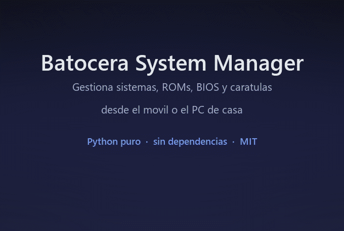</a>

**Proyecto de código abierto** · Licencia MIT · Hecho con Python puro (sin dependencias)  
[Instalación](#-instalación) · [Capturas](#-capturas) · [API](#-api-rest) · [FAQ](#-preguntas-frecuentes) · [Apoyar el proyecto](#-apoyar-el-proyecto)

</div>

---

## 🧭 Índice

- [¿Qué es?](#-qué-es)
- [Características](#-características)
- [Capturas](#-capturas)
- [Instalación](#-instalación)
- [Uso](#-uso)
- [Scraper de carátulas](#-scraper-de-carátulas)
- [Arquitectura](#-arquitectura)
- [API REST](#-api-rest)
- [Tests](#-tests)
- [Estructura del proyecto](#-estructura-del-proyecto)
- [Requisitos y compatibilidad](#-requisitos-y-compatibilidad)
- [Seguridad](#-seguridad)
- [Preguntas frecuentes](#-preguntas-frecuentes)
- [Roadmap](#-roadmap)
- [Contribuir](#-contribuir)
- [Apoyar el proyecto](#-apoyar-el-proyecto)
- [Licencia](#-licencia)

---

## ❓ ¿Qué es?

**Batocera System Manager Web** es una interfaz web autocontenida para administrar un equipo con
[Batocera](https://batocera.org) desde cualquier navegador de la casa: el móvil, la tablet o el PC.

EmulationStation sólo muestra los sistemas que ya están definidos en sus ficheros `es_systems.cfg`
(escritos a mano, en XML, por SSH). Esta herramienta convierte esa tarea en un formulario:
eligues un sistema de referencia de Batocera, ajustas nombre, extensiones, emulador, núcleo y tema,
y el manager escribe el `es_systems_<slug>.cfg` correcto y crea las carpetas necesarias.

Además del gestor de sistemas, incluye un **panel de control en vivo** (CPU, GPU, RAM, disco, red y
estado de EmulationStation leídos de `/proc` y `/sys`), un **monitor de ROMs y BIOS** que detecta qué
BIOS faltan en cada sistema, un **scraper multi-fuente** y un asistente de **arranque automático**.

No hay que compilar nada, ni instalar dependencias, ni tocar Node, Docker o bases de datos: es un
servidor HTTP de la librería estándar de Python que sirve una única página.

### Características

- **🕹️ Gestor de sistemas** — crea, edita y elimina sistemas personalizados con formulario completo,
  vista previa del XML y registro de lo que se escribe en disco.
- **📊 Panel de control en vivo** — CPU (uso, núcleos, temperatura), GPU (modelo, uso, VRAM, consumo),
  RAM, disco, red, y estado/PID de EmulationStation. Con refresco automático opcional.
- **🎲 Juego al azar + estadísticas** — tarjeta con carátula, ficha y descripción de un juego aleatorio
  de tu biblioteca, ranking de más jugados y horas totales.
- **🏆 RetroAchievements** — progreso y logros de tu perfil dentro del propio panel.
- **💾 Monitor de ROMs y BIOS** — inventario por sistema (número de ROMs, extensiones, subcarpetas) y
  verificación de BIOS: qué falta, en qué sistema, con subida manual, descarga automática y lista de
  omisiones.
- **🧲 Scraper multi-fuente** — ScreenScraper.fr, TheGamesDB e IGDB (Twitch), con imágenes guardadas
  como EmulationStation espera (`images/<rom>-image`, `-box`, `-wheel`, `-fanart`…).
- **🎨 Temas y assets** — temas instalados, tema activo, estructura de assets esperada y subida de
  logos, que se guardan como `art/logo.png` dentro del tema activo (si no tienes uno, Pillow genera
  un logo de relleno).
- **🚀 Arranque automático** — añade o quita el manager del `custom.sh` de Batocera con un clic, y
  avisa en pantalla si está corriendo en modo manual (lanzado a mano, sin arranque automático).
- **✏️ Edición de ROMs** — renombrar ficheros, actualizar metadatos, ver información de imágenes y
  subir/borrar carátulas por tipo.
- **🌐 Cero dependencias** — sólo la librería estándar de Python. Opcionalmente Pillow, y sólo para
  generar logos de relleno.

---

## 📸 Capturas

Todas las capturas están hechas sobre una instalación real (Batocera 43.1) y la IP local aparece
anonimizada.

### 📊 Panel de control

La portada resume el estado de la máquina: saludo con la versión de Batocera y el tiempo encendido,
contadores de sistemas, partidas y horas jugadas, el juego al azar y el rendimiento en vivo.

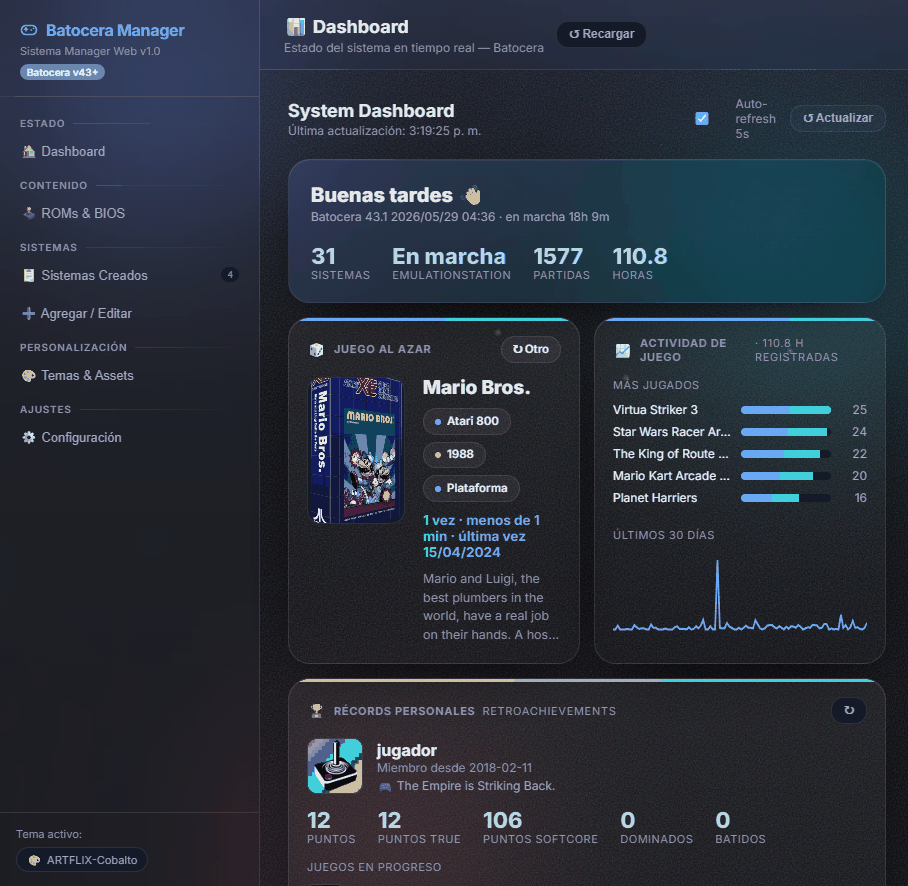

*Panel de control con KPIs en vivo, tarjeta de juego al azar y contadores de la biblioteca.*

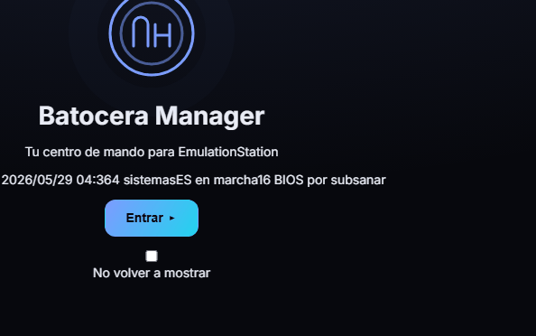

*Juego al azar (con carátula, ficha y descripción) junto al resumen de actividad y más jugados.*

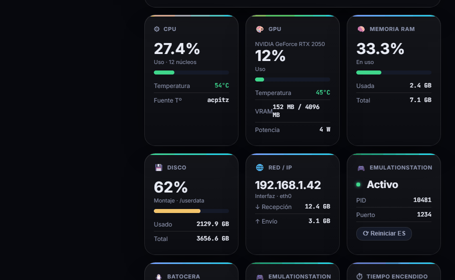

*Rendimiento en vivo: CPU, GPU, RAM, disco, red y estado de EmulationStation.*

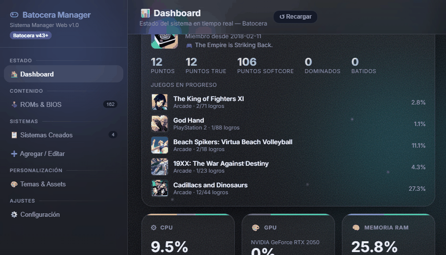

*Progreso y logros de RetroAchievements de tu perfil, integrados en el panel.*

### 🕹️ Sistemas

Los sistemas personalizados creados por el manager, con su tema, su `es_systems_<slug>.cfg` y su
carpeta de ROMs. Desde aquí se editan, se ve el XML generado o se borran.

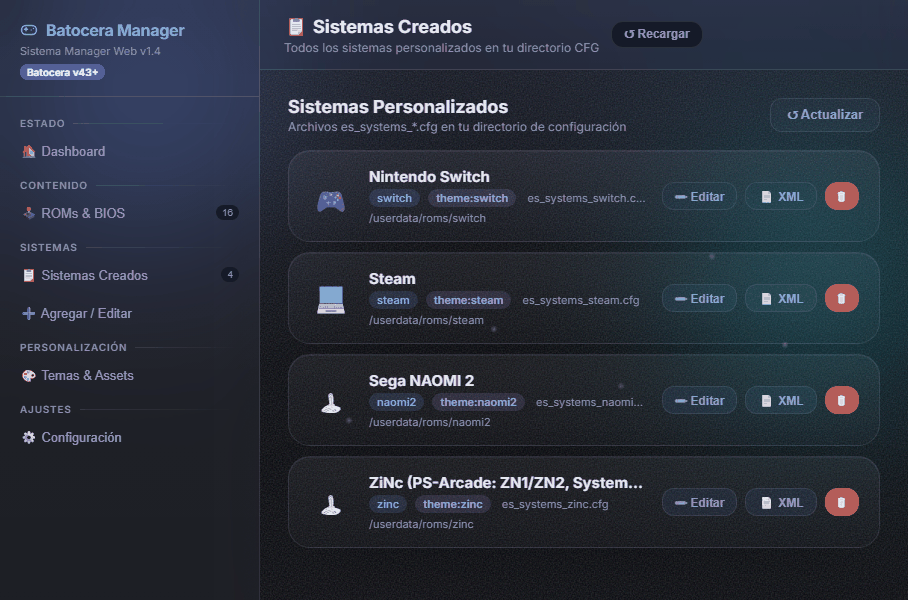

*Listado de sistemas creados con accesos directos a editar, ver XML y eliminar.*

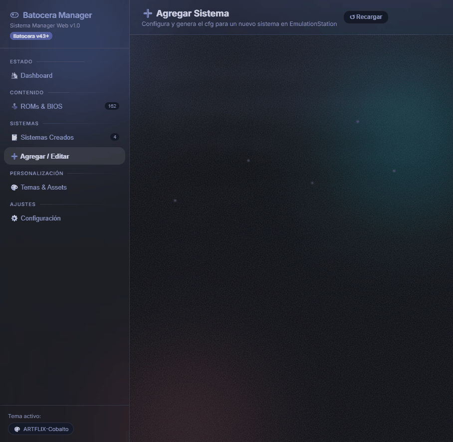

*Formulario de creación: sistema de referencia, datos, rutas, extensiones, emulador y logo.*

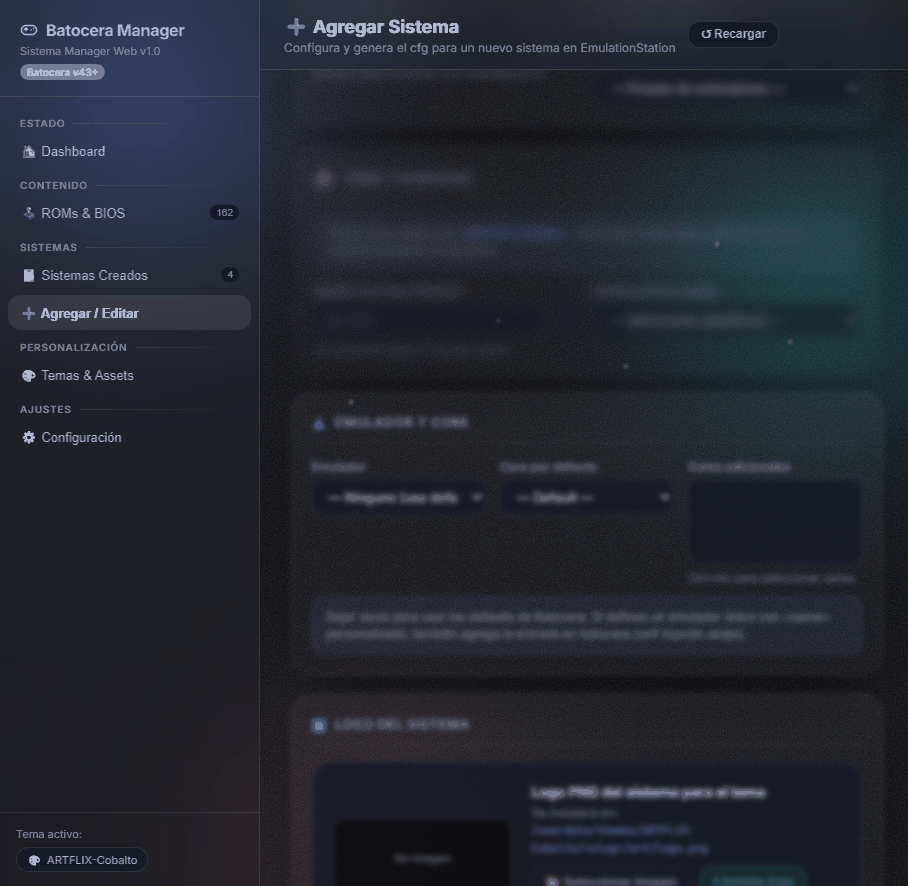

*Parte avanzada del formulario: tema, scraping, emulador, núcleo y descripción.*

### 💾 ROMs y BIOS

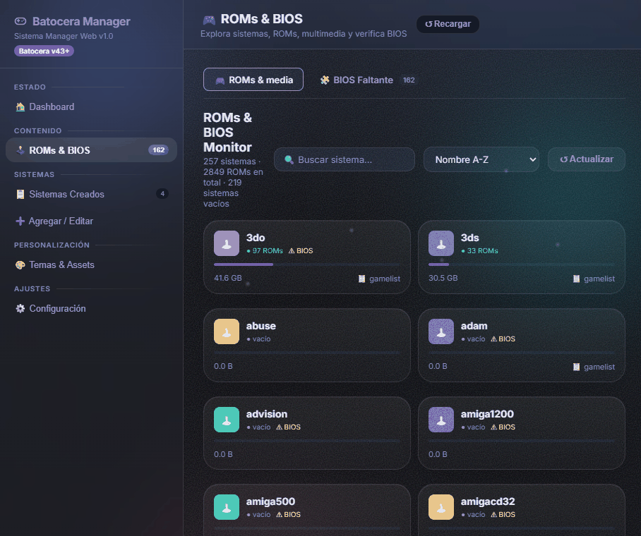

*Monitor de ROMs: sistemas detectados, número de ficheros y búsqueda inmediata.*

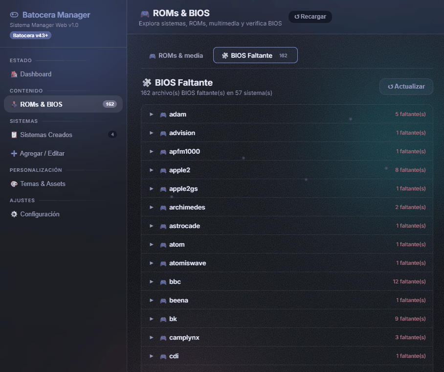

*Verificación de BIOS: cuántas faltan, en qué sistema y subida/descarga desde la propia web.*

### 🧲 Scraper

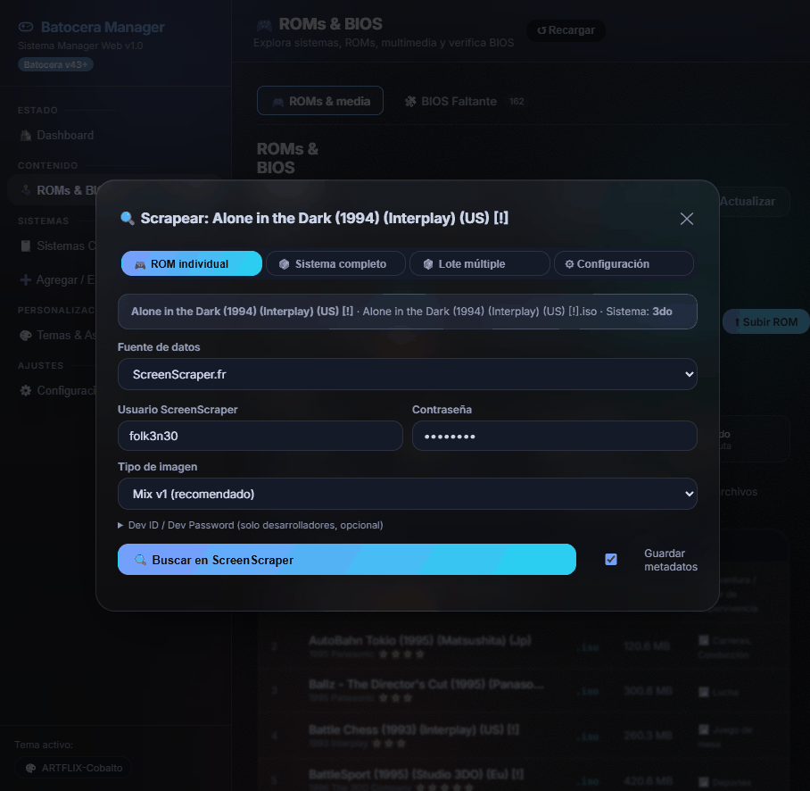

*Scraper de un juego concreto: fuente, búsqueda, previsualización y tipos de imagen a descargar.*

### 🎨 Temas y assets

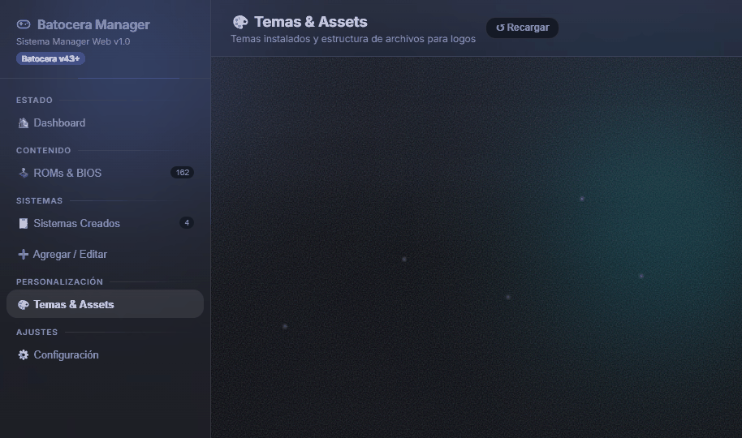

*Temas instalados, tema activo y estructura de assets que espera Batocera.*

### ⚙️ Configuración y arranque

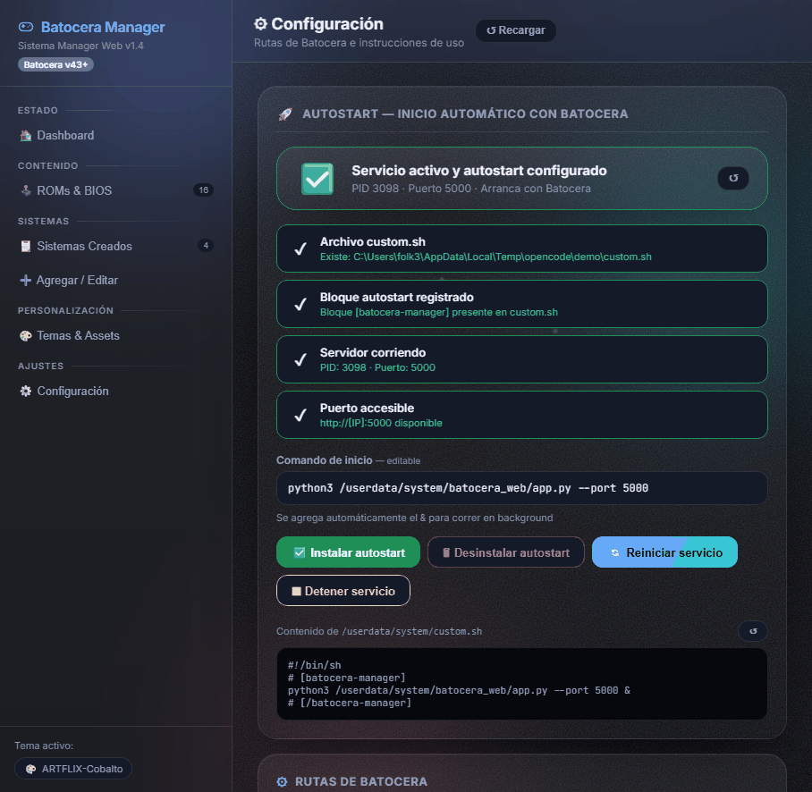

*Estado del servicio, arranque automático en `custom.sh` y aviso si corre en modo manual.*

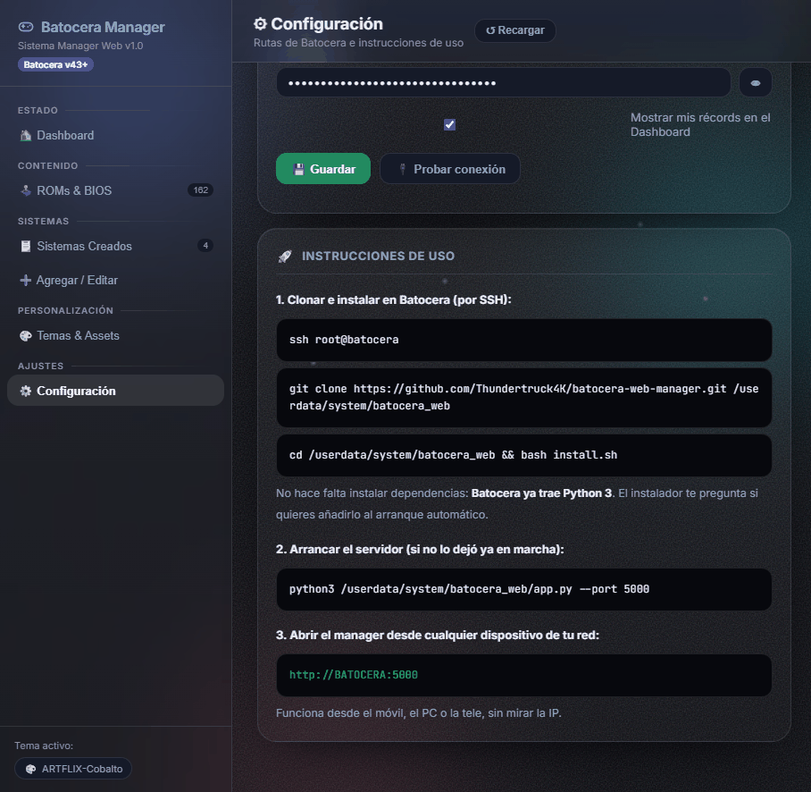

*Instrucciones integradas para resolver los avisos sin salir de la web.*

---

## 🚀 Instalación

Todo se instala desde la propia Batocera, por SSH. **No hace falta nada más que Python 3**, que ya
viene incluido en el sistema.

```bash
ssh root@BATOCERA

git clone https://github.com/Thundertruck4K/batocera-web-manager.git /userdata/system/batocera_web
cd /userdata/system/batocera_web
bash install.sh
```

(También puedes ejecutarlo directamente: `./install.sh`, ya es ejecutable.)

El instalador comprueba Python y Pillow (opcional), deja los ficheros en
`/userdata/system/batocera_web/` y **pregunta si quieres arranque automático**: si aceptas, añade un
bloque marcado a `/userdata/system/custom.sh` y arranca el manager en ese momento.

Al terminar verás algo así:

```
  ╭─────────────────────────────────────────────────────────
  │  Batocera System Manager · instalador
  │  destino: /userdata/system/batocera_web
  ╰─────────────────────────────────────────────────────────

  ◆ Python 3               ✔ Python 3.12.x
  ◆ Pillow (logos)         ✔ disponible

  ¿Añadir el manager al inicio de Batocera?
     Así se levanta solo cada vez que enciendas la consola.
  [S]í / [n]o: s
  ◆ Arranque automático    ✔ añadido a /userdata/system/custom.sh
  ✔ Arrancado ahora mismo en el puerto 5000

  ╰─ Listo. Abre http://BATOCERA:5000
```

### Opciones del instalador

| Variable | Por defecto | Para qué sirve |
|---|---|---|
| `BM_PORT` | `5000` | Puerto del servidor web |
| `BM_BASE_DIR` | `/userdata/system` | Carpeta base de Batocera |
| `BM_CUSTOM_SH` | `$BM_BASE_DIR/custom.sh` | Script de arranque que se modifica |
| `BM_PYTHON` | `python3` | Intérprete a usar |
| `BM_AUTOSTART` | *(pregunta)* | `s` / `n` para instalaciones desatendidas |
| `NO_COLOR` | — | Desactiva el color de la salida |

Ejemplo sin interacción: `BM_PORT=8080 BM_AUTOSTART=s bash install.sh`

### Actualizar a la última versión

Si ya lo tienes instalado (clonado antes), basta con:

```bash
cd /userdata/system/batocera_web
git pull
pkill -f "python3.*app.py"
sleep 1
./install.sh
```

El instalador detecta que los ficheros ya están en su sitio y solo reinicia el
servicio con el código nuevo.

### Arranque manual (sin autostart)

Si prefieres lanzarlo a mano (o probarlo antes de dejarlo fijo):

```bash
python3 /userdata/system/batocera_web/app.py --port 5000
```

El manager lo detecta: en **Configuración** aparece un aviso de *modo manual* y un botón para activar
el arranque automático con un clic.

> **Pillow (opcional).** Sólo se usa para generar logos de relleno cuando un sistema no tiene logo.
> Si quieres instalarlo: `python3 -m pip install pillow --break-system-packages`

---

## 📖 Uso

Una vez instalado, abre en el navegador:

```
http://BATOCERA:5000          # sustituye BATOCERA por el nombre o la IP de tu equipo
```

El servidor escucha en `0.0.0.0`, así que también funciona desde el móvil.

| Sección | Para qué sirve |
|---|---|
| **Dashboard** | Estado del sistema en vivo, juego al azar, estadísticas y RetroAchievements |
| **ROMs & BIOS** | Inventario de ROMs por sistema y verificación de BIOS (faltantes, subida y descarga) |
| **Sistemas Creados** | Sistemas personalizados: editar, ver su XML o eliminar |
| **Agregar / Editar** | Asistente para crear un sistema nuevo a partir de uno de referencia |
| **Temas & Assets** | Temas instalados, tema activo, estructura de assets y subida de logos |
| **Configuración** | Estado del servicio, arranque automático, rutas de Batocera y RetroAchievements |

Tras crear o modificar un sistema, Batocera necesita releer su configuración: el manager ofrece
reiniciar EmulationStation desde la propia interfaz.

---

## 🧲 Scraper de carátulas

El scraper funciona en tres modos (**un juego**, **un sistema completo** o **cola por lotes**) y
soporta tres fuentes:

| Fuente | Credenciales |
|---|---|
| **ScreenScraper.fr** (por defecto) | Usuario y contraseña de la cuenta |
| **TheGamesDB** | API key |
| **IGDB (Twitch)** | Client ID y Client Secret |

Las credenciales se leen de la configuración de Batocera (`batocera.conf`) y se guardan desde la
propia web. Las imágenes se escriben con la nomenclatura de EmulationStation
(`images/<rom>-image.png`, `-box`, `-wheel`, `-fanart`, `-marquee`, `-thumbnail`…), así que aparecen sin
tocar nada más. Se respetan los límites de peticiones de cada API (hilos máximos y pausa mínima).

---

## 🧱 Arquitectura

Intencionadamente sencilla: **un proceso, un fichero de servidor y una plantilla**.

```
Navegador  ──HTTP──▶  app.py (http.server)  ──▶  /userdata/system/…
                          │                      ├── configs/emulationstation/es_systems_<slug>.cfg
                          │                      ├── roms/<sistema>/…
                          └── templates/         ├── batocera.conf
                              index.html         └── batocera_manager_settings.json
```

- **`app.py`** — servidor HTTP puro (`http.server`) con todos los endpoints, lectura de
  `/proc` y `/sys` para las métricas, escritura de configuraciones de EmulationStation y los clientes
  de ScreenScraper, TheGamesDB e IGDB. Sin frameworks.
- **`templates/index.html`** — interfaz completa (HTML, CSS y JavaScript en un solo fichero). El
  servidor la sirve sustituyendo una serie de marcadores con los datos ya calculados, así que la
  primera pantalla se ve sin esperas.
- **`batocera_systems.json`** — catálogo de referencia con los sistemas y emuladores que trae
  Batocera; alimenta el formulario de creación (extensiones, núcleos y sistema de referencia).
- **Sin estado en memoria** más allá de la caché de ROMs (60 s) y de tokens de las APIs.

---

## 🔌 API REST

La interfaz se apoya en una API HTTP propia (JSON) que puedes usar por separado:

| Grupo | Endpoints |
|---|---|
| **Sistema** | `/api/info` · `/api/dashboard` · `/api/settings` · `/api/news` · `/api/fans` |
| **Servicio** | `/api/service/status` · `/api/service/install` · `/api/service/remove` · `/api/service/restart` · `/api/service/kill` · `/api/service/read-sh` |
| **EmulationStation** | `/api/es/status` · `/api/es/restart` |
| **Sistemas** | `/api/systems` · `/api/create` · `/api/preview` · `/api/batocera-systems` · `/api/themes` · `/api/upload-logo` |
| **ROMs** | `/api/rom-systems` · `/api/rom/rename` · `/api/rom/update-meta` · `/api/rom-image-info` · `/api/game-stats` · `/api/random-game` |
| **BIOS** | `/api/bios/all` · `/api/bios/missing` · `/api/bios/fetch` · `/api/bios/upload` · `/api/bios/missing/skip` · `/api/bios/missing/skipped` · `/api/bios/missing/unskip` |
| **Scraper** | `/api/scraper/config` · `/api/scraper/save-config` · `/api/scraper/search` · `/api/scraper/download` · `/api/scraper/scrape-system` · `/api/scraper/batch` |
| **RetroAchievements** | `/api/retroachievements` · `/api/retroachievements/test` |
| **Actualización** | `/api/update` |

---

## 🧪 Tests

La lógica del backend y los ayudantes de la interfaz están cubiertos con **281 tests** de `pytest`
(que no requiere dependencias del proyecto, sólo el propio pytest):

```bash
python -m pytest
# 281 passed in ~13s
```

---

## 📁 Estructura del proyecto

```
batocera_web/
├── app.py                    # servidor HTTP y toda la lógica (stdlib)
├── templates/
│   └── index.html            # interfaz completa (HTML + CSS + JS)
├── batocera_systems.json     # catálogo de referencia de sistemas de Batocera
├── install.sh                # instalador (Python, ficheros y arranque automático)
├── tests/                    # 281 tests con pytest
├── docs/
│   ├── media/demo.gif        # demostración
│   ├── screenshots/          # capturas del README
│   └── superpowers/          # diseño y planes del proyecto
├── LICENSE                   # MIT
└── README.md
```

---

## 💻 Requisitos y compatibilidad

| | |
|---|---|
| **Sistema** | Batocera **v43 o superior**, Linux (probado en 43.1) |
| **Python** | El Python 3 que ya incluye Batocera — no hay nada que instalar |
| **Dependencias** | Ninguna (Pillow es opcional, sólo para logos de relleno) |
| **Cliente** | Cualquier navegador moderno (móvil, tablet o PC) |
| **Rutas** | Escribe en `/userdata/system/`, `/userdata/roms/` y `batocera.conf` |

No funciona fuera de Batocera: lee `/proc`, `/sys` y las rutas de `/userdata`, que son específicas
del sistema.

---

## 🔒 Seguridad

Este manager está pensado para la **red de casa**: **no tiene autenticación**. Cualquiera que pueda
abrir `http://BATOCERA:5000` puede crear y borrar configuraciones, subir ficheros y reiniciar
servicios (en Batocera, el usuario es `root`).

- No lo expongas directamente a Internet.
- Si necesitas acceso desde fuera, usa una VPN (por ejemplo Tailscale o WireGuard) como si estuvieras
  en casa.
- Si tu red no es de confianza, valora mantenerlo apagado y arrancarlo sólo cuando lo uses.

---

## ❔ Preguntas frecuentes

**¿Necesito instalar Python o alguna librería?**  
No. Usa sólo la librería estándar de Python 3, la que ya trae Batocera.

**¿Puedo crear sistemas sin tocar XML a mano?**  
Sí, es justo el objetivo: eliges un sistema de referencia, ajustas los campos y el manager escribe el
`es_systems_<slug>.cfg` y crea las carpetas.

**¿Dónde guarda la configuración?**  
En `/userdata/system/batocera_manager_settings.json` (rutas, puerto, credenciales del scraper y de
RetroAchievements).

**¿Cómo quito el arranque automático?**  
Desde **Configuración** con un clic, o borrando el bloque marcado `# [batocera-manager]` …
`# [/batocera-manager]` de `/userdata/system/custom.sh`.

**¿Por qué me avisa de "modo manual"?**  
Porque el manager está arrancado a mano (`python3 app.py`) y no figura en el arranque automático de
Batocera: si reinicias, no volverá a levantarse. El aviso incluye el botón para activarlo.

**¿Sirve para Batocera v41 o v42?**  
Está desarrollado y probado en v43+; los ficheros y rutas que usa son los mismos en versiones
recientes, pero no hay garantía en versiones antiguas.

**¿Por qué no veo el logo de relleno de un sistema?**  
Porque Pillow es opcional; sin él, el manager no genera logos de relleno (el resto funciona igual).

**¿Me puede romper la instalación de Batocera?**  
Sólo escribe ficheros nuevos (`es_systems_<slug>.cfg`, imágenes y un bloque en `custom.sh`) y puedes
ver antes el XML que va a escribir. Aun así, haz copia de `/userdata/system/configs` si vas a tocar
mucho.

---

## 🗺️ Roadmap

Ideas anotadas, sin fechas:

- Autenticación opcional (usuario y contraseña) para redes poco fiables.
- Copia de seguridad y restauración de `es_systems_*.cfg` desde la web.
- Más fuentes de scraping y descarga de vídeos.
- Selección de idioma de la interfaz.
- Modo claro/oscuro y temas para la propia web.

---

## 🤝 Contribuir

¡Las contribuciones son bienvenidas! Es un proyecto abierto y sencillo de leer a propósito:

1. Abre una *issue* contando el problema o la idea.
2. Haz un *fork*, crea una rama y añade tus cambios.
3. Ejecuta `python -m pytest` y comprueba que todo sigue en verde.
4. Envía un *pull request* explicando el qué y el por qué.

Se agradece un estilo de código acorde con el resto (comentarios en español, sin dependencias
nuevas en el servidor) y que los cambios de interfaz conserven los identificadores de los tests.

---

## ☕ Apoyar el proyecto

Este manager nace de mi propia necesidad y lo comparto con quien le pueda servir. Si te ahorra
tiempo trasteando con el XML y quieres invitar al autor a un café, ¡se agradece!

<div align="center">

**PayPal** — [folk3n30@gmail.com](https://www.paypal.com/donate/?business=folk3n30%40gmail.com&no_recurring=0&item_name=Apoyar%20Batocera%20System%20Manager&currency_code=USD)

*Cualquier propina se destina a tiempo de desarrollo y a probar en más equipos.*

</div>

También ayuda mucho, y es gratis: dejar una ⭐ en el repositorio, contar tu experiencia en las
*issues* o compartirlo con quien tenga una Batocera.

---

## 📄 Licencia

Distribuido bajo la licencia **MIT**. Consulta el fichero [LICENSE](LICENSE) para más detalles.
Puedes usar, modificar y redistribuir el código, incluso comercialmente, manteniendo el aviso de
copyright.

---

<div align="center">

**Proyecto no oficial**: no está afiliado ni respaldado por el equipo de [Batocera](https://batocera.org).

Hecho con Python puro, sin dependencias, para la comunidad de Batocera. 🕹️

</div>
